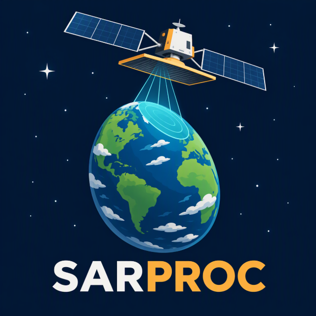

  

# SARPROC

 

Processing chains for synthetic aperture radar (SAR) satellite data: from raw or Level-1 products to
analysis-ready results for forest, vegetation and land monitoring.

SARPROC is run by the team **Earth Observation and Environmental Informatics** of
**Wageningen Environmental Research (WENR)**, part of **Wageningen University & Research (WUR)**.

## Missions

| Repository | Mission | Band | What it does |
|---|---|---|---|
| **Sentinel-1** | Copernicus Sentinel-1 | C | ESA SNAP processing of large areas and long time series on an HPC cluster |
| **BIOMASS** | ESA BIOMASS | P | finds products in the ESA MAAP catalogue, checks stack coverage, runs the BIOMASS Processing Suite from L0 to L2A forest products, and SAR tomography |
| **TanDEM-X** | DLR TanDEM-X | X | planned |
| **NISAR** | NASA-ISRO NISAR | L, S | planned |

## How we work

- **Python**, with reproducible environments and unit tests that run offline.
- **Heavy processing on the WUR HPC cluster** (Slurm); one self-continuing job chain per stack or
  tile, safe to restart after a failure.
- **Traceable products**: every result carries the IDs of its input products and the processor
  version used.
- **Documentation for users**, not only for developers: the steps should be clear to someone without
  HPC experience.

Some repositories are private while the work is ongoing.

## Contact

Team Earth Observation and Environmental Informatics, Wageningen Environmental Research:
[www.earthinformatics.eu](https://www.earthinformatics.eu)

Wageningen Environmental Research: [wur.nl/environmental-research](https://www.wur.nl/en/research-results/research-institutes/environmental-research.htm)
